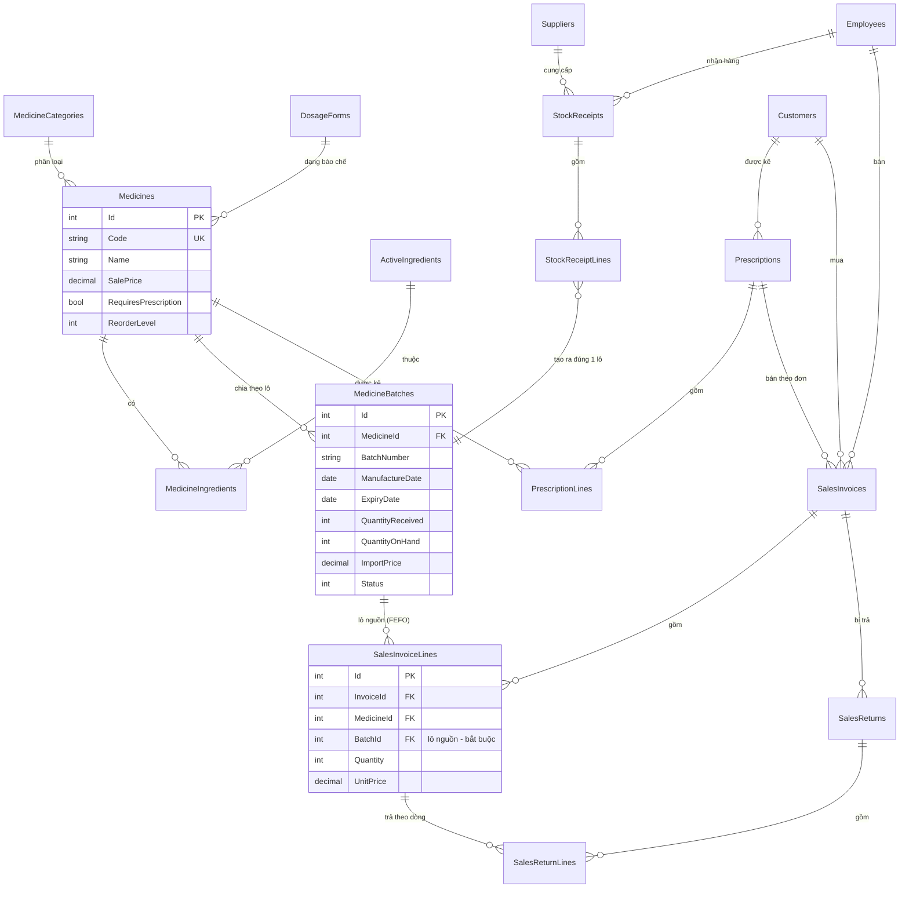

# ERD — PHARMACARE PRO

## Đọc ERD

- **MedicineBatches** là thực thể trung tâm: mọi biến động tồn kho đều qua lô.
- **StockReceiptLines → MedicineBatches** là quan hệ tạo sinh: mỗi dòng nhập sinh đúng 1 lô.
- **SalesInvoiceLines → MedicineBatches** là quan hệ truy xuất: mỗi dòng bán chỉ rõ lô nguồn, cho phép tra ngược hóa đơn → lô → phiếu nhập → nhà cung cấp khi có thông báo thu hồi thuốc.
- Bảng Identity của ASP.NET Core (AspNetUsers, AspNetRoles...) quản lý tài khoản đăng nhập; `Employees.Username` liên kết mềm tới tài khoản Identity.
